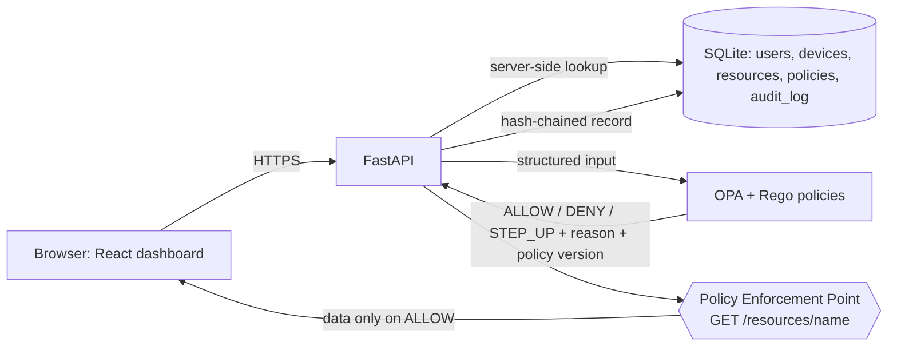

# ZeroGuard — Zero Trust Access Policy Tracker

ZeroGuard decides whether a user may access a resource using **identity status, role, MFA state and device posture**, enforces that decision at the resource, and records every decision with the policy ID and version that produced it. Policies are written in **Rego** and evaluated by **Open Policy Agent (OPA)**.

> Portfolio prototype, not a production-certified system. Device posture is **simulated**, and identity is a **demo header** (see [Known limitations](#known-limitations)).

**Live demo:** `https://zeroguard-8o7k.onrender.com/` (free tier: first load after idle takes ~1 minute; data resets on restart) · **Demo walkthrough:** [docs/demo-script.md](docs/demo-script.md) · **Threat model:** [docs/threat-model.md](docs/threat-model.md)

## What it demonstrates
- **Policy as code:** rules live in `policies/` (Rego + data), separate from application code, with 10 Rego unit tests.
- **Deny by default, deterministic precedence:** `DENY > STEP_UP_AUTHENTICATION > ALLOW`; missing or malformed input is denied.
- **Real enforcement:** `GET /resources/{name}` returns data only on `ALLOW` (403 on deny, 401 on step-up). The frontend cannot bypass it.
- **Trusted context:** role, MFA and device posture are read from the server database, never from the request.
- **Fail closed:** if OPA is down, times out or returns something invalid, access is denied (`POLICY_ENGINE_UNAVAILABLE`).
- **Audit evidence:** each decision stores user, resource, device, reason, policy ID and version in a **hash-chained log**; `/audit/verify` detects edits.
- **Admin dashboard (React + TypeScript):** overview charts, repeated-denial flags, searchable audit log with CSV export, policy list, request simulator.

## Architecture

One Docker container runs FastAPI (public) and OPA (listening on `127.0.0.1` only). The React build is served by FastAPI.

## Decision flow
1. Request arrives with a user ID, optional device ID and a resource name.
2. FastAPI looks up the user, device and resource in the database and builds the OPA input.
3. OPA evaluates `data.zeroguard.policies` and returns `{effect, reason, policy_id, policy_version}`.
4. The backend validates the answer (allow-listed effects). Any error becomes `DENY`.
5. The PEP enforces it, and the decision is appended to the audit log.

## Policies (seed data in `policies/data.json`)
| ID | Effect | Rule |
|---|---|---|
| P001 | ALLOW | HR → `hr_db` with MFA and a compliant device |
| P002 | DENY | Developers → `hr_db` |
| P003 | STEP_UP | High-sensitivity resource without MFA |
| P004 | DENY | Admin on a non-compliant device, sensitivity medium or higher |
| P005 | DENY | Interns → `source_code` |
| P006 | ALLOW | Developers/admins → `source_code` with MFA and compliant device |
| P007 | ALLOW | Anyone → `wiki` |

Seed users: `aman` (developer), `priya` (HR), `root` (admin, non-compliant device), `ravi` (intern), `sam` (HR, disabled), `neha` (HR, no MFA).

## API
| Method | Path | Purpose |
|---|---|---|
| POST | `/access-request?resource=…` | Evaluate and log a decision |
| GET | `/resources/{name}` | Protected resource (PEP) |
| GET | `/audit`, `/audit/verify`, `/stats`, `/policies` | Admin only (admin role + `ADMIN_KEY` when deployed) |
| GET | `/health`, `/health/policy` | Liveness and policy-engine reachability |

Interactive docs at `/docs`. The `X-User-Id` / `X-Device-Id` headers stand in for a verified session.

## Run it
**Deploy (Docker, Render):** push the repo, create a Render Blueprint from `render.yaml`, copy `ADMIN_KEY` from the service environment into the dashboard. The build log runs the backend tests and Rego tests.

**Locally (no Docker):**
```
cd backend && pip install -r requirements.txt && python -m pytest -q
python -m uvicorn app.main:app --reload            # http://127.0.0.1:8000
cd ../frontend && npm install && npm run build      # optional: React UI served by FastAPI
opa test policies policies/tests -v                 # optional: Rego tests
```

## Testing
- 21 backend tests (pytest): every policy outcome, enforcement, admin protection, tamper detection, OPA failure modes.
- 10 Rego tests (`opa test`): precedence, default deny, invalid input, disabled policies.
- Both run automatically in the Docker build and passed on Render.

## Known limitations
- **Identity is a demo header**, not authentication. Next step: OIDC (Keycloak or a hosted provider) with signed tokens.
- **Device posture is simulated** (seeded flags), not from endpoint management.
- **SQLite on a free instance resets on restart.** Next step: PostgreSQL.
- No sessions or revocation, risk scoring, rate limiting, or policy editing from the UI yet.
- The audit hash chain detects edits but does not stop someone with full database write access from rebuilding it.

## Roadmap
PostgreSQL + migrations → OIDC login → sessions and revocation → risk signals → policy versioning UI → rate limiting.
